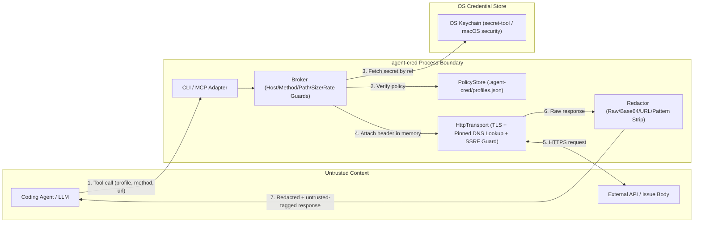

# Detailed Threat Model & Architecture Boundaries

## 1. Evidence From Local Reverse Engineering

The design of `agent-cred` directly addresses four concrete failure classes observed in real agent harnesses and software factories:

1. **Hardcoded Tokens in Shared Configs**: Storing bearer tokens in repository configuration files exposes live credentials to every fork, clone, and agent context window. `agent-cred` separates `.agent-cred/profiles.json` (non-secret policy, safe to inspect) from `SecretStore` (OS keychain).
2. **Same-UID Test-Runner Escapes (`Bash($TEST_CMD)`)**: When an agent can edit test files and execute the test runner with the developer's OS UID, any secret injected into the environment is trivially exfiltrated. `agent-cred` eliminates environment injection and provides a narrow HTTP capability interface.
3. **Process-Table (`argv`) Token Exposure**: Passing `-H "Authorization: Bearer $TOKEN"` on a `curl` command line exposes the secret to `ps`, shell history, and agent tool transcripts. `agent-cred` attaches credentials in-process using Node's native `https` module.
4. **Indirect Prompt Injection via Issues and APIs**: Issue bodies and API responses are untrusted input. `agent-cred` enforces deterministic host/method/path allowlists in code and wraps MCP responses in `<untrusted_api_data>` delimiters.

## 2. Trust Boundaries

## 3. Defense-in-Depth Controls

- **Fail-Closed Policy Parsing**: Unknown fields, wildcard hosts, non-HTTPS URLs, and `query` auth schemes are rejected before any secret is loaded.
- **No Shell Execution**: Every internal process call (`secret-tool`, `security`) uses `spawnSync` with `shell: false`, explicit argument arrays, and `stdin` piping.
- **No Redirect Following**: Credentials are never forwarded to `Location` headers on `3xx` responses.
- **Local Redacted Audit Trail**: `.agent-cred/audit.jsonl` (`0600`) records timestamps, profile names, methods, redacted URLs, status codes, and durations—never secret values or remote telemetry.
